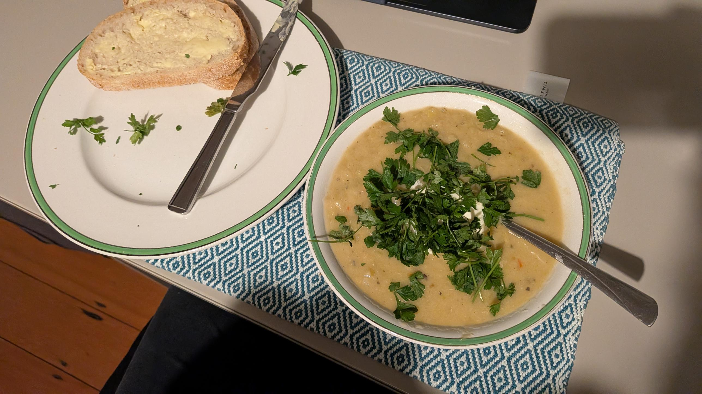

# Leek and Potato Soup
> Source: https://www.enfieldveg.co.uk/recipes/leek-and-potato-soup

Serves about 5, ~35 min. Adapted from Delia Smith's leek and potato soup. Changes: added red chilli, whole garlic and bay leaves, loads of salt and pepper, a bit less milk, an extra potato, crème fraîche in the bowl rather than on top.

## Ingredients

- leeks (4 medium)
- onion (1 medium)
- potatoes (3 medium)
- red chilli (1)
- garlic cloves (4)
- bay leaves (3)
- butter (50g)
- vegetable stock (850ml)
- milk (about 200ml, all I had, the original says 275ml)
- salt and pepper
- crème fraîche, to serve (about 2 tbsp)
- parsley, to serve

## Method

0. Eat some bread and butter, because you started cooking too late.
1. Prep the veg. Trim, halve and finely slice the leeks, then wash well and drain. Chop the onion small and chop the red chilli. Peel and dice the potatoes. Peel the garlic and leave the cloves whole because lazy.
2. Melt the butter in a large, heavy pan. Add the leeks, onion, potatoes, red chilli, garlic and bay leaves. Stir to coat, add a shit ton of salt and pepper, cover and sweat on very low heat for about 15 minutes. Stir when you remember.
3. Add the stock and milk, bring to a gentle simmer, cover and cook for about 20 minutes until the veg is soft. Keep the heat low so the milk doesn't boil over. Do the washing up.
4. Remove the bay leaves, cool slightly and blend until smooth. Reheat gently, then taste and adjust the seasoning.
5. Stir crème fraîche into each bowl and tear parsley over the top.

I think I left it simmering for about 30 minutes rather than 20 while doing the washing up.
